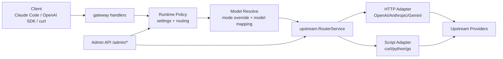
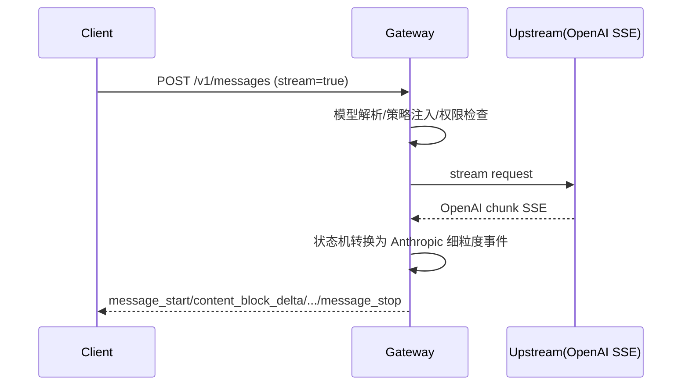

# Repository Guidelines（中文）

> 本文件是仓库协作指南（中文版）。英文版请见 `AGENTS.md`。两者并行维护，功能与流程说明应保持一致。

## 1. 目标与适用范围
本仓库是 `cc-gateway`：一个面向 Claude Code / Anthropic Messages / OpenAI 协议的统一网关。本文面向日常贡献者、维护者与自动化代理（Agent），用于统一开发、测试、文档与提交流程。

## 2. 仓库结构与职责边界
- `cmd/cc-gateway/`：服务入口。
- `internal/`：后端核心实现。
  - `gateway/`：HTTP 路由与协议处理。
  - `upstream/`：上游适配、路由、流式转换。
  - `settings/`：运行时配置存储。
  - `modelmap/`：模型映射。
  - 其余目录按领域拆分（`scheduler/`、`probe/`、`toolruntime/` 等）。
- `tests/`：唯一测试目录，按模块镜像组织。
- `web/admin/`：后台前端（Vue + Vite）。
- `scripts/`：开发辅助脚本、脚本适配器示例。
- `configs/`：配置样例。
- `docs/`：文档唯一目录（设计、说明、示例）。
- `logs/`：运行日志目录（通过 `.gitkeep` 保持目录存在，日志文件默认忽略）。

## 3. 架构总览

## 4. 请求处理关键流程（流式）

## 5. 本地开发命令
- 后端全量测试：`go test ./...`
- 一键构建并运行：`bash scripts/build_run_gateway.sh`
- 仅后端启动：`bash scripts/build_run_gateway.sh --no-ui --port 18080`
- 加载 GLM 本地路由样例：`source <(bash scripts/use-glm-local-env.sh)`
- Admin 前端开发：
  - `cd web/admin && npm run dev`
  - `cd web/admin && npm run build`

## 6. 编码规范
- Go 版本：`1.22`。
- 所有 Go 代码提交前执行 `gofmt`。
- 新功能优先放在明确领域目录，避免“跨模块拼接逻辑”。
- 命名约定：
  - 包/文件名小写、语义明确。
  - 导出标识符 `CamelCase`，内部 helper `camelCase`。
- 变更 API 行为时，同步更新 `docs/` 与配置样例。

## 7. 测试与质量门禁
- 测试框架：Go 标准 `testing`。
- 测试文件必须是 `tests/**/_test.go`。
- 推荐策略：
  1. 先补失败用例（或新增回归用例）。
  2. 再改实现。
  3. 最后跑 `go test ./...`。
- 涉及流式协议、模型映射、后台管理接口时，必须包含对应模块测试。

## 8. 配置、安全与日志
- 禁止提交真实密钥；使用环境变量（如 `ADMIN_TOKEN`、上游 API Key）。
- 生产环境禁止默认 `ADMIN_TOKEN`。
- 日志策略：
  - `logs/` 目录保留（`logs/.gitkeep`）。
  - 日志文件忽略提交（`.gitignore` 中 `logs/*`，仅保留 `.gitkeep`）。

## 9. 提交与 PR 规范
- 建议提交信息：`<scope>: 
`，例如：
  - `upstream: add openai sse to anthropic stream state machine`
  - `gateway: support admin upstream runtime update`
- PR 最少包含：
  1. 变更动机与范围。
  2. 影响路径/API。
  3. 测试证据（命令 + 结果）。
  4. 若改 `web/admin`，附截图或录屏。

## 10. Agent 协作约束
- 不要把测试放到 `internal/` 或根目录；统一放在 `tests/`。
- 不要把正式文档放到 `scripts/`；统一放在 `docs/`。
- 修改协议转换与路由逻辑时，优先保证向后兼容，并补回归测试。
